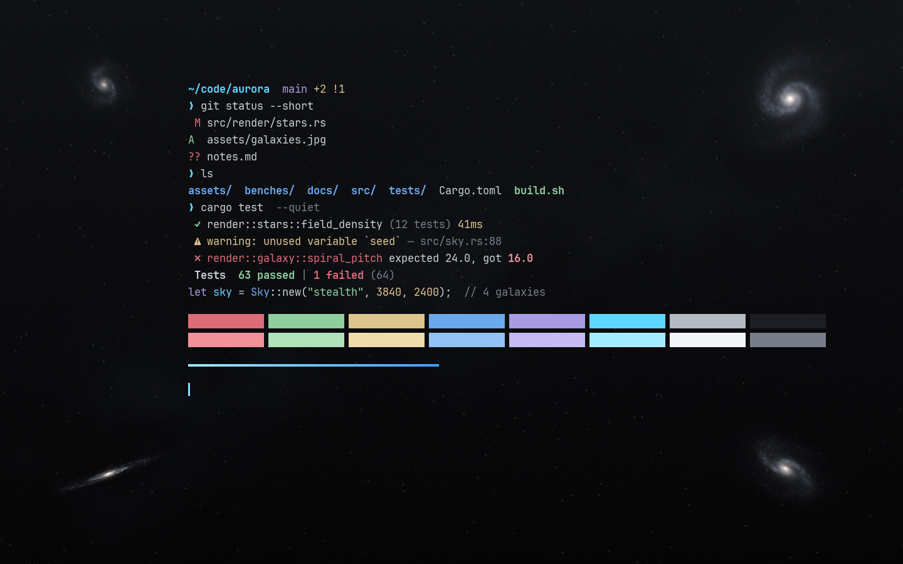

# Stealth — a Warp theme

A quiet near-black theme for [Warp](https://www.warp.dev/) with ice-blue accents, soft pastel ANSI colors and a
faint starfield: a Milky Way haze, a fine grain and four distant galaxies tucked into the corners.



## Install

Copy both files into Warp's themes folder, then pick **Stealth** in Settings → Appearance → Themes.

**macOS**

```sh
mkdir -p ~/.warp/themes && cd ~/.warp/themes
curl -fLO https://raw.githubusercontent.com/batuhantoker/warp-theme-stealth/main/stealth.yaml
curl -fLO https://raw.githubusercontent.com/batuhantoker/warp-theme-stealth/main/stealth_galaxies.jpg
```

**Linux**: same commands in `${XDG_DATA_HOME:-$HOME/.local/share}/warp-terminal/themes`.
**Windows**: put both files in `%APPDATA%\warp\Warp\data\themes`.

Warp can take a few minutes to notice a new themes folder; restarting Warp picks it up straight away.

The preview uses JetBrainsMono Nerd Font Mono at 14 pt (Settings → Appearance → Text), but any monospace font works.

## Palette

|         | black     | red       | green     | yellow    | blue      | magenta   | cyan      | white     |
|---------|-----------|-----------|-----------|-----------|-----------|-----------|-----------|-----------|
| normal  | `#1c1e23` | `#de6b78` | `#8fcf9f` | `#dcc58e` | `#6aa9ee` | `#a99be3` | `#5fd7ff` | `#b4bac4` |
| bright  | `#777d8a` | `#f2919b` | `#b0e2bb` | `#efdcaa` | `#93c3f5` | `#c6bbf0` | `#a6ecff` | `#f3f5f8` |

Background `#101114` → `#050506` (top to bottom), foreground `#c9ced6`, accent `#9eeaff` → `#3d9eff`,
cursor `#7fe1ff`.

## The background

`stealth_galaxies.jpg` (3840×2400) is generated by [`scripts/stars.py`](scripts/stars.py), not taken from a photo,
so it is free to reuse under this repo's license. Its base is the theme's own background gradient, so lowering
`opacity` in the YAML only fades the stars, never the background color.

To tweak it (star counts, galaxy placement, resolution via `W, H` at the top):

```sh
pip install numpy pillow
python3 scripts/stars.py stealth_galaxies.jpg
```

Warp caches background images by file name, so give a changed image a new name and update `path:` in
`stealth.yaml`.

## License

[MIT](LICENSE)
